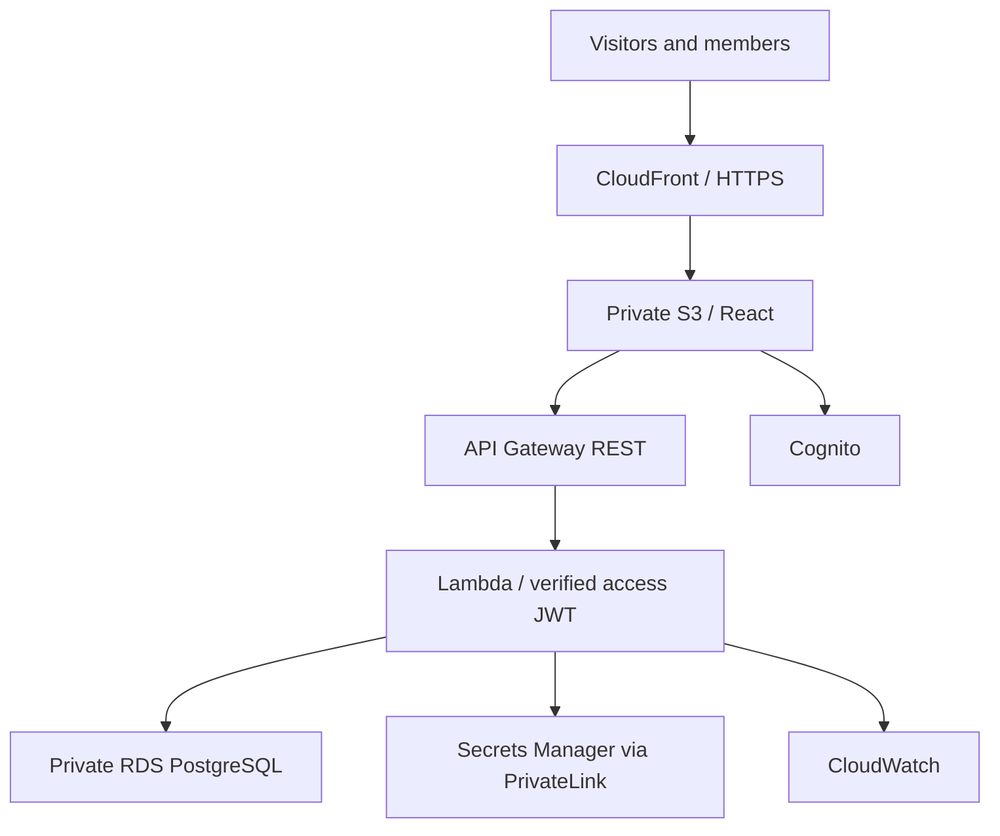

# Architecture decisions

The application is a TypeScript npm monorepo with an actual HTTP API and PostgreSQL queries. The local server adapts the same request handler used by Lambda; there is no browser database or fake production API.

Authorization uses the current database role/status on every request, so disabling an account or reducing its role takes effect immediately even while a JWT is still valid. Cognito access JWT signatures, issuer, expiration, token use and client ID are verified by aws-jwt-verify. Public routes expose only church settings, upcoming events and active ministry descriptions. Cognito post-confirmation creates a MEMBER user and a linked member in one transaction.

ADMIN manages members, users and settings; ADMIN/PASTOR manage services, ministries, events, reports and attendance corrections; STAFF searches members and records attendance; MEMBER only accesses their own profile and attendance. Attendance deletion is ADMIN-only. Backend authorization is authoritative.

Member QR codes contain a 256-bit random identifier, with no personal data. A QR card is a reusable credential presented to authenticated staff, not proof of identity or presence. Staff should confirm the person at check-in. Admin can rotate a compromised QR token. Tokens are never logged. Unique `(member_id, service_id)` handles simultaneous scans atomically. The transaction shares locks on the active member/service so deactivation cannot race a check-in.

The private database spans two AZs; production uses Multi-AZ and deletion protection. A single NAT gateway enables Cognito signing-key discovery/rotation. Secrets Manager uses a two-AZ interface endpoint. Lambda concurrency (10) and pool sizes (3) limit connections; this is appropriate for 200–1,000 members. Production needing AZ-resilient external key retrieval should provision one NAT per AZ, increasing cost.

RDS credentials are managed by AWS in Secrets Manager rather than supplied to Terraform. The initial application uses the dedicated database master account; restrict database credentials to this app/environment. For stronger separation, create a limited runtime SQL role and a separate migration secret before larger deployments. The AWS IAM role can retrieve only the environment’s database secret. Terraform state is encrypted/versioned with native S3 lockfiles.

Photo fields accept HTTPS URLs rather than binary uploads. Use approved church-hosted images; no insecure arbitrary file upload endpoint is exposed. Event registration flags are informational; capacity-booking/payment is outside this build.
